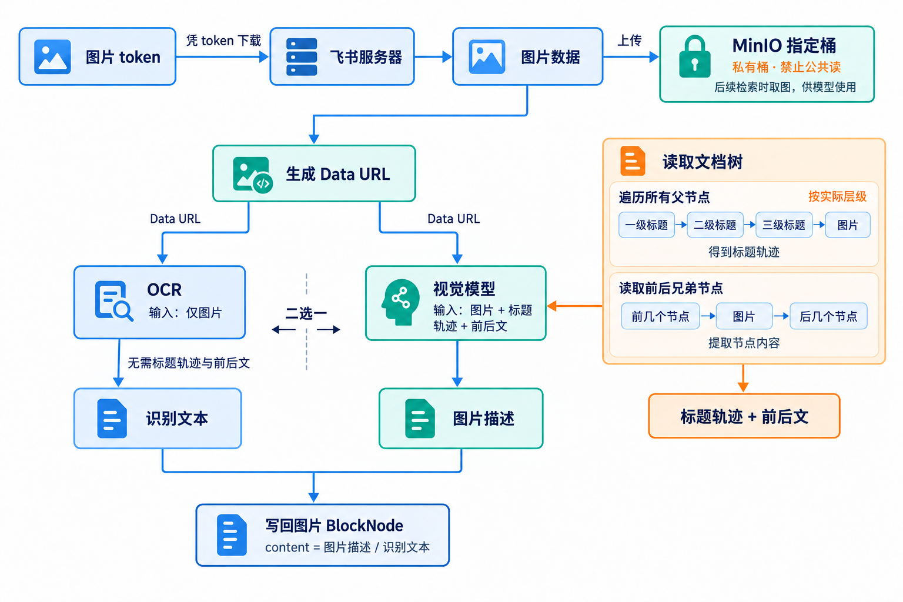

# 销售常见问题

> 本文为课程演示使用的虚构业务资料，所有产品和服务约定仅用于学习文档加载。

## 产品版本

- 标准版：适合小型团队，提供知识库问答。
- 专业版：适合跨部门协作的成长型企业，提供权限管理和业务报表。
- 企业版：适合大型团队，支持私有化部署。

选择版本时，应先确认使用人数、资料规模和权限要求。对于只想验证单个场景的客户，可以先安排小范围试用；对于已有明确部署要求的客户，应尽早邀请技术人员参与评估。

## 需求沟通

### 首次会议需要了解什么？

应了解客户当前如何查找资料、哪些问题重复出现，以及资料由谁维护。例如，销售需要查询价格政策，客服需要查找故障处理步骤，管理人员需要了解不同部门的资料更新情况。

### 客户只提供功能清单怎么办？

请客户为每个关键功能补充一个具体场景，包括使用者、输入资料、期望结果和当前处理方式。业务场景有助于判断需求优先级，也便于后续设计演示和验收案例。

## 报价流程

确认客户需求后，由销售负责人审核正式报价。报价单应包含产品版本、授权人数、订阅周期和实施服务范围，客户提出的特殊要求应单独注明。

1. 收集需求，确认使用部门和预计上线时间。
2. 核对版本权益，识别需要额外评估的内容。
3. 提交报价审批，记录折扣和赠送服务的原因。
4. 向客户发送正式报价，并说明报价有效期。

## 试用与演示

### 试用时应该准备哪些资料？

建议准备产品介绍、销售政策、服务手册和常见问题等具有代表性的资料。资料应经过脱敏处理，并由客户确认可以用于试用。文件数量不必很多，但应覆盖试用要验证的主要问题。

### 如何判断试用是否达到目标？

试用前列出一组真实问题，记录预期答案和参考来源。试用结束后，对比回答准确性、来源完整性和查找资料所需时间，并保留无法回答或回答错误的案例。

## 部署与权限

### 私有化部署前需要确认什么？

需要确认服务器资源、网络访问方式、模型服务连接、存储方案和运维责任。客户提出的数据隔离、备份或审计要求，应由技术团队评估后再写入交付范围。

### 所有人都能查询全部资料吗？

不能。资料访问范围应与业务权限一致。试用时应准备不同角色的账号，分别验证可访问和不可访问的资料，避免只测试管理员账号。

## 实施与交接

- 销售负责说明合同范围和已确认的客户需求。
- 实施人员负责配置、资料接入和上线辅导。
- 客户指定资料负责人，维护文档内容并确认权限。

上线前应再次检查资料版本、联系人、交付清单和验收安排。对于新增需求，应明确负责人及处理时间，避免口头沟通后没有后续记录。

## 续费与支持

续费前应回顾实际使用情况，了解哪些部门经常使用系统、哪些问题尚未解决，以及下一周期是否需要增加用户或接入更多资料。

客户反馈问题时，建议提供问题原文、发生时间、相关文档和期望结果。如果涉及敏感资料，应通过双方约定的渠道提交，避免在公开讨论中传播。
